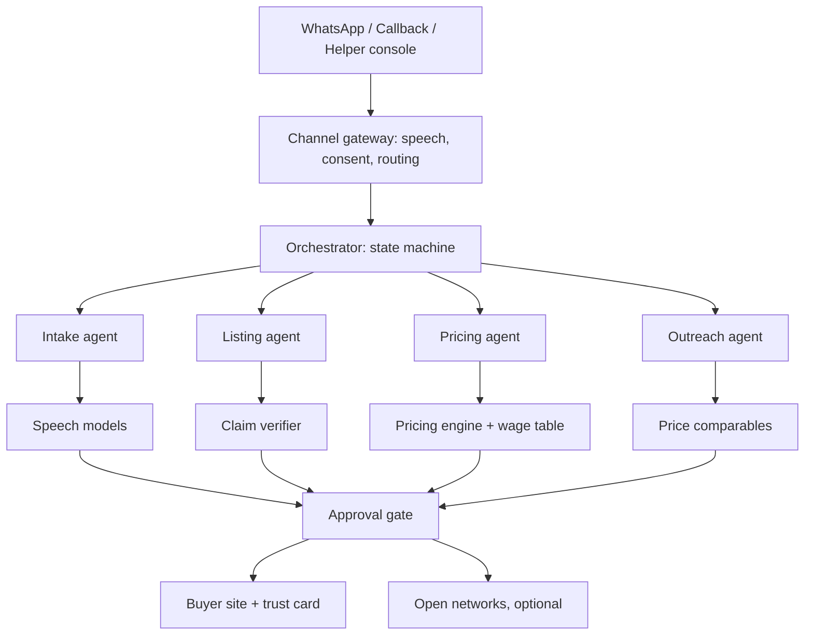

# KalaaMulyam

**Artisans get paid for their hours first.**

A voice-first, agent-based assistant that helps artisans sell without typing, apps, or digital skills. It drafts the story and listing, prices each piece from the maker's real materials and hours with a wage floor checked against market rates, and publishes only after the artisan says yes.

Built for **Tech4Bharat 2026** (Global Accelerator Vision Summit), **Problem 7.1**, **Agentic AI** track.

> Status: work in progress for prototype.

---

## The problem

Weavers, potters, and wood and metal craftspeople mostly sell through traders and fairs. The trader sets the price, the maker's name disappears, online listing needs photography and digital skills, and bulk buyers are negotiated with blind to market rates. Margins stay thin and the craft's story is lost.

A 2026 CCI–IHD study across five states found the average handicraft and handloom worker earning about ₹270 a day, below the prescribed minimum wage in every state surveyed ([summary](https://www.ihdindia.org/whatsnew/CCI-Summary-English-Booklet.pdf)).

## The idea

Most voice-to-listing tools guess a price from the market. MakerFirst starts from the **maker's wage**, then checks the market:

```
floor = materials + (active hours × wage per hour) + overheads
```

- Market above the floor: suggest a price inside the market range.
- Market below the floor: warn the artisan honestly, and never lower the price silently.
- Too few comparables: say so, and mark confidence as low.

Nothing is published, quoted, or accepted without the artisan's logged approval.

## How it works

1. The artisan sends a voice note and photos on WhatsApp, or asks for a callback on a basic phone.
2. Agents draft the story and listing, and read them back in the artisan's language.
3. The pricing engine builds a price card with sources.
4. The artisan approves by voice or keypad.
5. The listing goes live with a maker page and QR trust card.
6. Buyer enquiries and bulk orders return to the artisan as a short summary and a drafted reply.

### Architecture



Design rules:

- **The orchestrator is plain code.** The LLM works inside each step.
- **Outward actions need an approval record.** Publish, send quote, and accept can only run if the artisan's approval for that exact action is logged.
- **The LLM never computes a price.** It extracts inputs, and a deterministic function does the maths.
- **Every listing claim needs evidence.** Each statement must trace to the artisan's words or a photo, or it is removed.
- **Photos get crop and brightness fixes only,** with no generative edits of the product.
- **Humans take over** on low speech confidence, bulk orders, or a price below the wage floor.
- **The audit log is hash-chained,** so tampering is detectable.

## Pricing engine

```python
from dataclasses import dataclass
from statistics import quantiles

@dataclass(frozen=True)
class PriceInput:
    materials: float          # rupees, wastage included
    active_hours: float       # hands-on hours only
    wage_per_hour: float      # from the wage table (state, category, date)
    overheads: float          # tools, fuel, packing
    comps: tuple[float, ...]  # comparable selling prices, rupees

def fair_price(p: PriceInput) -> dict:
    if p.active_hours <= 0:
        raise ValueError("active_hours must be positive")
    floor = p.materials + p.active_hours * p.wage_per_hour + p.overheads
    n = len(p.comps)
    if n < 3:
        return {"outcome": "thin_data", "floor": round(floor),
                "suggested": round(floor * 1.15), "confidence": "low"}
    q1, q2, q3 = quantiles(p.comps, n=4, method="inclusive")
    if q3 < floor:
        effective = (q2 - p.materials - p.overheads) / p.active_hours
        return {"outcome": "below_floor", "floor": round(floor),
                "market": (round(q1), round(q3)),
                "effective_wage_at_market": round(effective)}
    suggested = min(max(q2, floor), q3)
    return {"outcome": "above_floor" if q1 >= floor else "overlap",
            "floor": round(floor), "market": (round(q1), round(q3)),
            "suggested": round(suggested),
            "confidence": "high" if n >= 15 else "medium" if n >= 5 else "low"}
```

Illustrative examples (materials ₹120, 6 hours at ₹60, overheads ₹60, so floor ₹540):

| Comparables (₹) | Result |
|---|---|
| 700, 750, 780, 800, 850, 900 | `above_floor`, market 758 to 838, suggested 790, confidence medium |
| 400, 420, 450, 480, 500 | `below_floor`, market 420 to 480, about ₹45 an hour at market price |

The 15% thin-data margin and the confidence thresholds are placeholders to tune from pilot data.

### Wage floor

The default wage comes from a versioned table: state, category, zone, hourly rate, effective date, and source URL. The agent shows the source and date whenever it quotes a floor, and a cooperative can adjust it.

Wage notifications are used as a **benchmark**. They are not a legal compliance claim, and self-employed artisans are generally not covered by them directly. Check the current notification for your state before citing a figure.

## Status

- [ ] Voice note and photo intake
- [ ] Speech-to-text and text-to-speech in [Telugu / Hindi]
- [ ] Extraction of materials, hours, and story
- [ ] Claim verifier
- [ ] Pricing engine with unit tests
- [ ] Wage table loader
- [ ] Approval gate and audit log
- [ ] Buyer page with QR trust card
- [ ] WhatsApp integration
- [ ] Callback / helper console
- [ ] Negotiation agent (bulk orders)
- [ ] Open-network publishing

## Repository layout

```
makerfirst/
├── gateway/        # channel handling, speech, consent
├── orchestrator/   # task state machine, approval gate
├── agents/         # intake, listing, pricing, outreach
├── services/       # pricing engine, claim verifier, comparables search
├── data/           # sample wage table and comparables (sample data only)
├── tests/
├── docs/           # architecture, mockups
└── README.md
```

## Getting started

```bash
git clone [repo url]
cd makerfirst
python -m venv .venv && source .venv/bin/activate
pip install -r requirements.txt
cp .env.example .env      # add your API keys
pytest                    # run the pricing tests

pip install -r requirements.txt
pytest
uvicorn app:app --reload      # from the repo root, then open /docs
```

## Tech stack

 Python, FastAPI, Postgres, object storage, an LLM with tool calling, Indic speech models, WhatsApp Cloud API.

## Evaluation plan

| Area | Metric |
|---|---|
| Speech | Word error rate on real artisan recordings, per dialect |
| Extraction | Field accuracy for materials, hours, and units |
| Claim verifier | Unsupported claims caught in a seeded test set |
| Pricing engine | Unit tests for all three outcomes |
| Approval gate | Zero outward actions without an approval record |
| Business | Earnings per hour before and after, listings approved unchanged, buyer response with versus without the maker's story |

## What we will prove next

1. Whether artisans' earnings per hour improve.
2. Whether buyers respond or pay more when they see the maker's story and price breakdown.
3. Whether dialect accuracy and price-data coverage hold up in a real cluster.

Rollout is one cluster at a time. Each new region needs a language pack, a wage table, and local price comparables. The agents, approval gate, and trust card stay the same.

## Privacy and responsible use

- Collect only what pricing and listings need, and record consent before storing audio or calling.
- Keep artisans' cost and wage data private unless they agree to share it.
- Check current obligations under the Digital Personal Data Protection Act and call-recording rules before any pilot.


## References

- CCI–IHD, *Economics of Indian Craft* (2026): https://www.ihdindia.org/whatsnew/CCI-Summary-English-Booklet.pdf
- The Migration Story, on Bengal's tant handloom weavers (March 2026): https://themigrationstory.com/post/im-an-artist-but-being-a-labourer-is-my-destiny-decline-in-tant-handlooms-forces-west-bengals-weavers-to-migrate-for-work/
